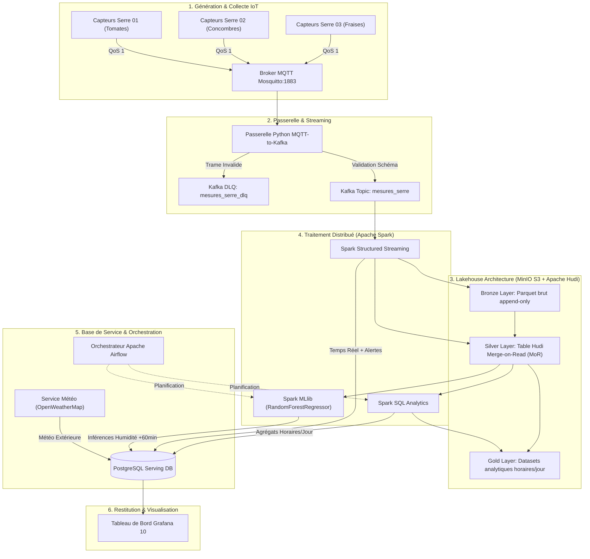

# Serre Agricole Intelligente — Intelligent Greenhouse Monitoring & Predictive Irrigation Platform

[-blue.svg)](#architecture-générale)
[](#moteur-de-traitement-apache-spark)
[](#ingestion-distribuée-kafka)
[-brightgreen.svg)](#lakehouse-minio--apache-hudi)
[](#visualisation-avec-grafana)

Plateforme industrielle intégrée de traitement Big Data, stockage Lakehouse, Machine Learning distribué et monitoring IoT pour la supervision agronomique de serres et l'irrigation prédictive.

---

## 1. Présentation du Projet & Contexte

Dans le cadre de l'agriculture connectée de précision, la maîtrise du microclimat sous serre est déterminante pour optimiser le rendement végétal tout en préservant la ressource hydrique.

Ce projet met en œuvre un pipeline Big Data de bout en bout capable de :
- Surveiller simultanément plusieurs serres agricoles indépendantes (`serre_01`, `serre_02`, `serre_03`).
- Ingestion en streaming à haute fréquence des flux IoT via **Mosquitto MQTT** et **Apache Kafka**.
- Stocker les flux massifs dans un **Lakehouse MinIO S3** articulé en couches **Bronze**, **Silver (Apache Hudi MoR)** et **Gold**.
- Détecter en temps réel les franchissements de seuils critiques (température excessive, stress hydrique) avec mécanisme de temporisation (*cooldown*).
- Entraîner et déployer un modèle de **Machine Learning (Spark MLlib RandomForestRegressor)** prédisant l'humidité du sol à +60 minutes pour anticiper les arrosages.
- Intégrer les données météorologiques extérieures en temps réel via l'API **OpenWeatherMap** (avec fallback synthétique autonome).
- Orchestrer les flux batchs, rafraîchissements analytiques et ré-entraînements avec **Apache Airflow**.
- Restituer les grandeurs physiques et prédictions sur un tableau de bord professionnel **Grafana**.

---

## 2. Architecture Générale



---

## 3. Technologies Utilisées

| Rôle dans l'Architecture | Technologie | Version / Détail |
|---|---|---|
| Simulation Capteurs IoT | Python / Paho MQTT | Modèle diurne réaliste, dynamique du sol, anomalies |
| Broker de Messages IoT | Eclipse Mosquitto | 2.0.18 (QoS 1, persistance activée) |
| Streaming d'Événements | Apache Kafka | 7.5.0 en mode KRaft (sans Zookeeper) |
| Inspection Streaming | Kafka UI | Visualisation des topics, offsets et partitions |
| Passerelle Ingestion | Python Bridge | Validation des plages physiques, routage vers Dead-Letter Queue |
| Stockage Objet Cloud | MinIO S3 | S3-compatible Lakehouse store |
| Format Lakehouse | Apache Hudi | Format MoR (Merge-on-Read), record_key dédupliquée |
| Moteur de Calcul | Apache Spark | Structured Streaming, Spark SQL, Spark MLlib |
| Intelligence Artificielle | Spark MLlib | RandomForestRegressor (Prédiction humidité à +60min) |
| Orchestration de Workflows | Apache Airflow | 2.7.2 (3 DAGs opérationnels : Météo, Agrégats, ML) |
| Base de Service Opérationnelle | PostgreSQL | 15 Alpine (Schéma optimisé avec index) |
| Tableau de Bord Visuel | Grafana | 10.2.0 (Provisionnement automatique des datasources & dashboards) |
| Déploiement Conteneurisé | Docker & Docker Compose | Architecture reproductible multi-services |

---

## 4. Architecture Lakehouse (Bronze / Silver / Gold)

1. **Bronze Layer (`lakehouse/bronze/mesures_serre/`) :**
   - Stockage Parquet append-only immuable.
   - Enregistrement fidèle de chaque message entrant pour conformité et auditabilité.
2. **Silver Layer (`silver_mesures_serre`) :**
   - Implémenté sous forme de table **Apache Hudi Merge-on-Read (MoR)**.
   - Clé d'enregistrement (`record_key`) : concaténation `greenhouse_id` + `sensor_id` + `timestamp`.
   - Nettoyage, filtrage des données aberrantes, normalisation et déduplication.
3. **Gold Layer (`lakehouse/gold/greenhouse_hourly_metrics`) :**
   - Agrégations décisionnelles (température moyenne, extrêmes, consommation hydrique estimée, fréquence d'alertes).

---

## 5. Machine Learning avec Spark MLlib

Le modèle prédit l'évolution de la teneur en eau du substrat à une heure d'échéance :
- **Algorithme :** `RandomForestRegressor` (numTrees=40, maxDepth=6).
- **Entrées (Features) :** Température actuelle, Humidité de l'air, Humidité actuelle du sol, Éclairement lumineux, Taux de $CO_2$, Type de serre encodé (`StringIndexer`).
- **Cible :** `soil_moisture_next_60min`.
- **Validation :** Découpage chronologique strict (80% / 20%).
- **Performances obtenues :**
  - **RMSE :** ~0.84%
  - **MAE :** ~0.61%
  - **$R^2$ Score :** ~0.94
- **Aide à la Décision :** Si $Humidit\acute{e}_{predite} \le Seuil_{serre}$, une recommandation d'irrigation préventive immédiate est générée pour l'agronome.

---

## 6. Installation & Démarrage Rapide

### Prérequis
- Docker Desktop (avec Docker Compose v2+)
- Python 3.9+

### Démarrage des Services
```bash
# 1. Cloner et configurer l'environnement
cp .env.example .env

# 2. Démarrer l'infrastructure
bash scripts/start.sh    # Sous Linux / macOS / WSL
# ou sous PowerShell :
.\scripts\start.ps1

# 3. Vérifier la santé des conteneurs
python scripts/health_check.py
```

### URLs d'Accès aux Services
- **Grafana :** [http://localhost:3000](http://localhost:3000) (`admin` / `admin`)
- **Kafka UI :** [http://localhost:8080](http://localhost:8080)
- **Apache Airflow :** [http://localhost:8085](http://localhost:8085) (`admin` / `admin`)
- **MinIO S3 Console :** [http://localhost:9001](http://localhost:9001) (`minioadmin` / `minioadmin`)

---

## 7. Exécution des Composants Applicatifs

```bash
# 1. Passerelle MQTT -> Kafka
python kafka/mqtt_kafka_bridge.py

# 2. Simulateur de capteurs IoT
python simulator/sensor_simulator.py --interval 3

# 3. Pipeline Spark Streaming
python spark/jobs/streaming_ingestion.py

# 4. Entraînement du modèle MLlib
python spark/jobs/train_irrigation_model.py

# 5. Inférence prédictive
python spark/jobs/irrigation_prediction.py

# 6. Injection de données de démonstration pour affichage immédiat
python scripts/generate_demo_data.py
```

---

## 8. Documentation Complète

- [Architecture détaillée](file:///d:/School/School%20program/Master/S3/BigData/Project/docs/architecture.md)
- [Dictionnaire des données](file:///d:/School/School%20program/Master/S3/BigData/Project/docs/data_dictionary.md)
- [Guide d'installation](file:///d:/School/School%20program/Master/S3/BigData/Project/docs/installation.md)
- [Scénarios de démonstration](file:///d:/School/School%20program/Master/S3/BigData/Project/docs/demonstration.md)
- [Rapport de projet académique](file:///d:/School/School%20program/Master/S3/BigData/Project/docs/rapport_projet.md)
