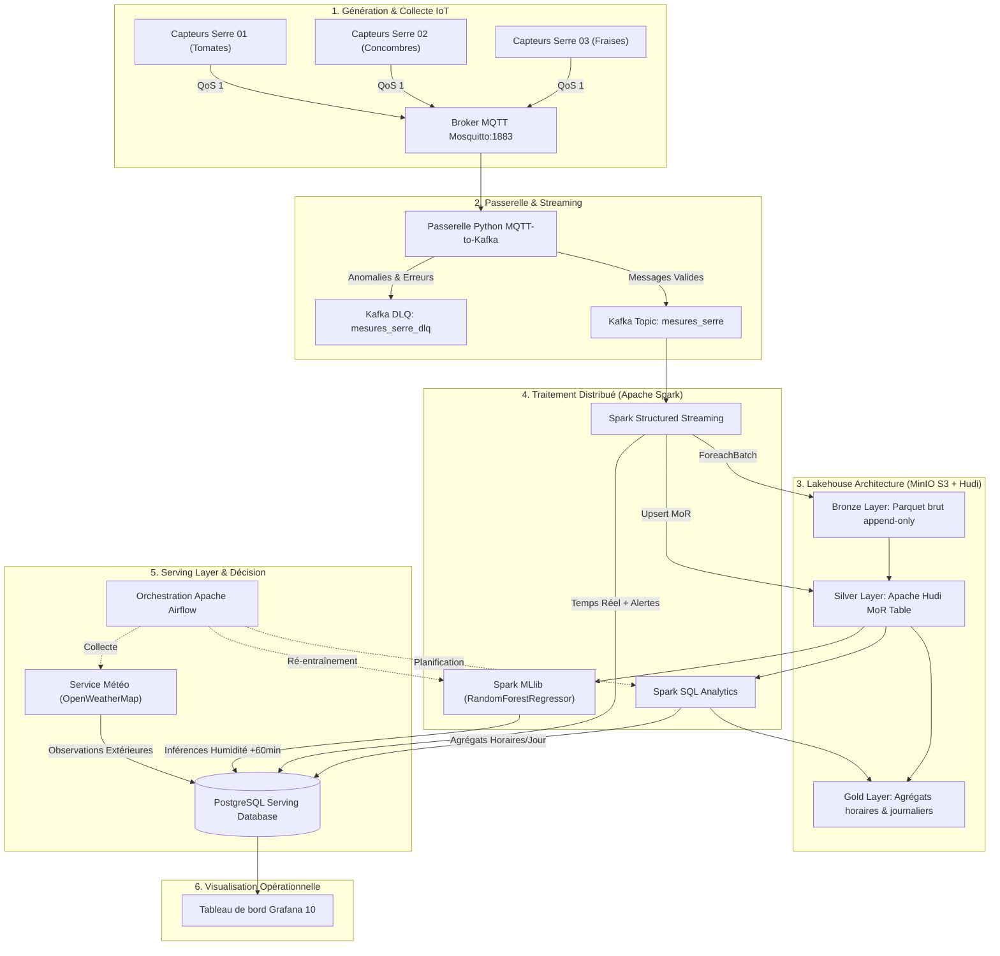
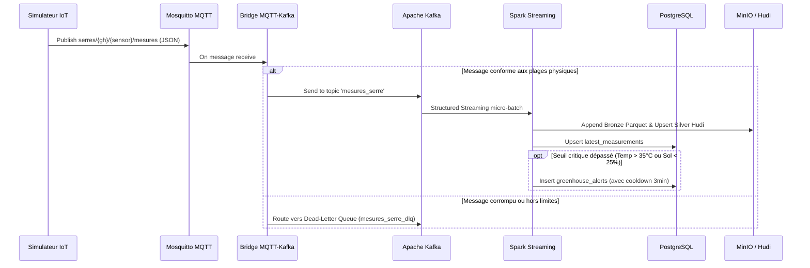

# Architecture Système — Serre Agricole Intelligente

## 1. Vue d'Ensemble Globale

La plateforme met en œuvre un pipeline Big Data complet, de la captation IoT distribuée jusqu'à la prise de décision prédictive et la visualisation opérationnelle.

---

## 2. Flux Détaillé d'Ingestion & Validation

---

## 3. Pipeline Machine Learning (Spark MLlib)

```mermaid
flowchart LR
    Hist["Historique Données Silver"] --> Prep["Préparation & Encodage"]
    Prep --> Split["Découpage Chronologique (80/20)"]
    Split --> Train["Entraînement RandomForest"]
    Train --> Eval["Évaluation (RMSE, MAE, R²)"]
    Eval --> Save["Sauvegarde Modèle & Métriques"]
    Save --> Infer["Inférence Humidité Sol (+60min)"]
    Infer --> Decis["Recommandation d'Irrigation"]
    Decis --> PG[("PostgreSQL serving")]
```

